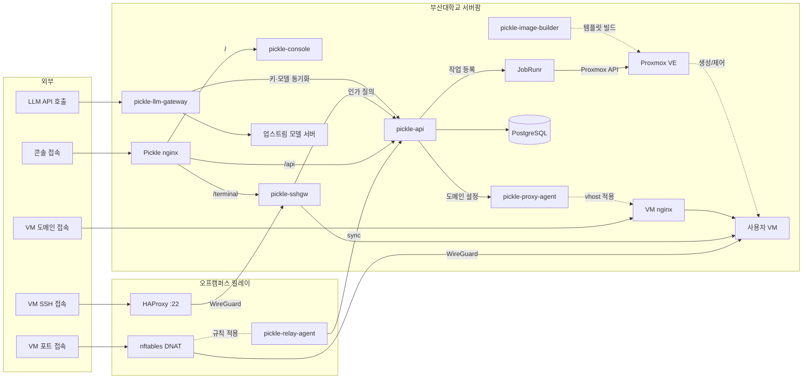

# pickle-proxy-agent

부산대학교 클라우드 플랫폼(Pickle)의 리버스 프록시 제어 에이전트예요.

사용자가 콘솔에서 도메인을 공개하면 [pickle-api](https://github.com/PNUops/pickle-api)가
해당 FQDN의 설정 전체를 이 에이전트에 보내고, 에이전트가 nginx를 그 설정대로 맞춰요.
표준 라이브러리만 사용하는 단일 정적 Go 바이너리예요.

라우팅 정보의 원본은 API 서버의 데이터베이스이고, nginx 설정은 거기서 파생된 산출물이에요.
에이전트는 소유 include 디렉터리에서 도메인별 vhost와 구성 확인 파일을 관리해요.
nginx 트리의 다른 부분은 건드리지 않아요.

소유 include 디렉터리의 `_pickle_reload_proof.conf`와 `_pickle_reload_proof.sock`은 새
nginx 구성 확인용으로 예약해요. 도메인 목록의 정리 대상에 포함하지 않아요.

## 전체 구조

```
[제어]   pickle-api ──도메인 설정(HTTP)──▶ proxy-agent ──vhost 렌더·검증──▶ nginx
[데이터] 방문자 ──HTTPS──▶ nginx ──▶ 사용자 VM의 웹 서비스
```

에이전트는 제어 경로에만 있어요. 방문자 트래픽은 에이전트를 지나지 않으므로,
에이전트가 멈춰도 이미 공개된 도메인은 계속 서빙돼요.

## 주요 기능

플랫폼은 VM 신청과 승인, 생성, SSH와 웹 터미널 접속, 도메인 공개, 만료와
삭제까지를 다뤄요. 이 레포지토리가 맡는 부분은 아래와 같아요.

- **도메인 공개 적용**: 사용자가 콘솔에서 공개한 도메인이 실제로 VM의 웹 서비스에 닿도록
  프록시를 맞춰요.
- **인증서 준비**: 플랫폼 서브도메인은 준비된 인증서를 쓰고, 사용자가 연결한 도메인은
  도메인별 인증서를 발급하고 갱신해요.
- **공개 해제 정리**: 공개를 내리면 라우팅과 설정, 그 도메인에만 쓰이던 인증서까지 함께
  거둬요.
- **실패 격리**: 검증을 통과하지 못한 설정은 반영되지 않고, 이미 반영된 설정이 그대로
  유지돼요.
- **대상 제한**: 프록시가 가리킬 수 있는 곳은 사용자 VM 네트워크 안으로 한정돼요.
- **적용 상태 보고**: FQDN마다 어느 세대까지 반영됐는지와 인증서 상태를 조회할 수 있게
  내놓아요.
- **전체 재동기화**: 스냅샷을 통째로 받아 다시 렌더하고, 목록에 없는 설정은 거둬요.

## 동작 방식

모든 변경은 단일 직렬 큐를 지나 한 번에 하나씩 처리돼요.

```
요청 수신 → vhost 렌더 → nginx -t 검증 → reload → 새 구성 응답 확인 → 결과 보고
                              │ 어느 단계든 실패하면
                              ▼
                     직전 파일 상태로 롤백 (이미 반영된 설정은 그대로)
```

FQDN마다 단조 증가하는 `generation`을 영속화하므로, 이미 적용된 세대 이하의 요청은
no-op(`409`)이에요. 네트워크 재시도가 몇 번을 오든 결과가 같아요.

세대와 인증서 상태는 임시 파일에 쓴 뒤 원자 교체로 영속화해요. 적용 도중 프로세스가
죽어도 상태 파일이 반쯤 쓰인 채 남지 않아요.

새 구성의 Unix socket 응답을 확인한 뒤 적용 세대를 기록해요. 응답에는 후보 vhost 집합의
해시와 일회용 난수가 들어가요. 10초 안에 확인되지 않으면 이전 파일을 복원하고 복원 구성도 다시 확인해요.
복원이 확인되지 않은 오류도 별도로 보고해요. 실패한 세대는 그대로 재시도할 수 있어요.
이 확인 경로는 TCP listener와 공개 응답 헤더를 만들지 않아요.

인증서는 두 갈래예요. 플랫폼 서브도메인은 자기 루트 도메인의 와일드카드 인증서를
사용해요. `certRef`의 `wildcard:<루트>`가 인증서의 루트를 지정하며, 설정에 없는 루트는
적용을 거부해요. 이 와일드카드 인증서는
운영자가 발급해 대상 호스트에 설치하고, 에이전트는 설정으로 받은 경로만 참조해요.
Let's Encrypt 와일드카드 발급에는 DNS-01 검증이 필요해요. 사용자
커스텀 도메인은 도메인별 Let's Encrypt 인증서를 certbot(HTTP-01, webroot)으로
발급해요. 발급 전에는 챌린지 전용 vhost를 먼저 올려 두고 인증서가 준비되면 정식 HTTPS
vhost로 바꾸는 2단계 렌더를 사용해요. 발급이 실패해도 적용 자체는 실패하지 않고
`/status`에 드러나요.

커스텀 도메인을 내리면 vhost와 함께 그 도메인의 인증서와 갱신 설정도 지워요.
정리 대상은 갱신 설정(`renewal/<도메인>.conf`)으로 확인해요. 남은 설정은 갱신 실패를
반복할 수 있어요. 정리가 실패해도 공개 해제는 성공하며 `/status`에서 오류를 확인할 수 있어요.

## API 표면

내부 브리지 주소(`172.30.1.10:9443`)에만 바인드해요. 이 주소로 향하는 DNAT이 없으므로
외부에서는 도달할 수 없어요.

- `POST /apply`: 단일 FQDN의 설정 전체를 받아 vhost를 렌더하거나 지워요
- `POST /sync-all`: 전체 스냅샷으로 세트를 재렌더하고, 매니페스트에 없는 vhost는 정리해요
- `GET /status`: 헬스, FQDN별 적용 세대, 커스텀 도메인 인증서 상태

각 `/apply` 요청과 `/sync-all.routes[]` 항목은 선택적으로 다음 필드를 받아요.

```json
{ "sourcePolicy": { "allowedCidrs": ["192.0.2.0/24", "2001:db8::/32"] } }
```

필드 생략은 기존 접근 동작을 유지해요. `{"allowedCidrs":[]}`는 해당 도메인의 backend
접근을 모두 거부하며 전체 공개는 `0.0.0.0/0`과 `::/0`을 명시해요. `null`, 목록 누락,
중복 CIDR과 호스트 비트가 남은 CIDR은 거부해요. canonical IPv4/IPv6 네트워크 CIDR을
최대 128개 받으며, bare IP와 DNS 이름은 받지 않아요. 교내 프리셋은 호출자가 실제 CIDR로
확장해 전달해요. 정책을 바꾸면 기존과 같이 `generation`을 올려요.

`GET /status`의 `capabilities`는 `source-acl-v1`을 포함해요. 호출자는 해당 capability를
확인한 에이전트에만 정책을 전송해야 해요. 지원 광고와 적용 세대는 설정 확인이며,
실제 외부 허용과 거부 경로의 검증을 대신하지 않아요.

에이전트 쪽에는 출발지 정책을 따로 켜는 스위치가 없어요. 이 바이너리를 배포한 뒤
현재 `/status`에서 capability를 확인하고, 그 다음 API producer를 활성화해요. 전용 HTTP
PROXY 수신 경로를 사용하는 배치는 listener와 trusted peers를 함께 설정해야 해요. 둘 중
하나만 있으면 기동을 거부하므로, 신뢰한 peer 없이 PROXY 주소를 정책 입력으로 쓰지 않아요.

## 보안 경계

공유 bearer 토큰과 소스 IP 허용 목록을 둘 다 통과해야 해요. 토큰이 비어 있으면 부팅을
거부해요. 자리표시자 토큰도 부팅 단계에서 걸러내요. 렌더 입력도 검증해 프록시 대상은
사용자 VM 네트워크 내부 주소만 허용해요.

방문자의 주소는 TLS 종단 계층이 앞에 붙여 준 PROXY 헤더에서 복원해 VM 쪽으로
`X-Real-IP`로 전달해요. 클라이언트가 요청 헤더에 넣은 주소는 신뢰하지 않아요.

정책은 복원한 주소 또는 직접 HTTP 연결의 peer 주소에 적용해요. HTTP 인증서 발급 중의
backend에도 같은 정책을 적용해요. ACME challenge와 backend에 닿지 않는 HTTPS redirect는
응답할 수 있어요. 정책을 쓰는 도메인과 전용 HTTP PROXY 수신 경로에서는 `X-Real-IP`와
`X-Forwarded-For`를 검증한 주소 하나로 덮고 `Forwarded`는 제거해요. 정책과 전용 수신
설정을 모두 생략하면 기존 헤더 출력도 유지해요.

HTTP 중계가 필요하면 일반 `:80`과 구분한 PROXY 수신 주소와 신뢰할 peer IP를 함께
설정해요. peer는 IP 리터럴만 받으며 XFF를 신뢰 경로로 사용하지 않아요. 호스트 방화벽도
전용 listener를 지정한 중계 peer에만 개방해야 해요. 정책 변경은 전체 설정의 `nginx -t`
통과 후 graceful reload로 반영해요. 진행 중인 응답을 강제로 종료하는 명령은 사용하지
않아요. [주소 복원](https://nginx.org/en/docs/http/ngx_http_realip_module.html),
[reload 동작](https://nginx.org/en/docs/control.html)을 기준으로 배치해요.

구성 확인 socket의 로컬 접근은 include 디렉터리 권한을 따라요. 이 디렉터리는 에이전트
소유여야 하고 group/other 쓰기를 허용하면 시작을 거부해요. 운영 환경에서는 root 소유로
보호하고 nginx master가 해당 디렉터리에서 Unix socket을 만들 수 있어야 해요.
예약 파일과 socket은 nginx가 사용하는 동안 임의로 지우지 않아요.

공개된 사이트의 vhost에는 요청 빈도와 동시 연결 상한이 함께 들어가요. 상한은 방문자
주소 단위로 걸리고, 인증서 발급 중에 잠깐 올라가는 챌린지 전용 vhost는 대상이 아니에요.

## 시작하기

```bash
scripts/verify.sh        # shellcheck → gofmt → go vet → build → test
```

Go 1.26이 필요해요. `verify.sh`는 `gofmt -l`로 포맷도 확인해요.

격리된 nginx 테스트 환경에서는 `PICKLE_TEST_NGINX_BIN`을 해당 바이너리 경로로 지정해
`go test ./internal/render -run TestSourcePolicyNginx`를 실행할 수 있어요. 실제 HTTP/TLS
허용과 거부, backend의 전달 헤더와 reload 중 활성 응답 보존을 확인해요.
격리 환경에 비어 있는 `:80`이 있으면 `go test ./internal/manager -run TestReloadProof`로
점유된 신규 포트의 적용 거부, 기존 구성 복원과 같은 세대 재시도를 확인할 수 있어요.

## 레이아웃

```
cmd/proxy-agent/      진입점 (env 설정 → 조립 → 서비스)
internal/config/      env 기반 설정            // 토큰이 비면 실행을 거부해요
internal/model/       pickle-api와 공유하는 wire 타입
internal/render/      vhost 템플릿 렌더와 입력 검증
internal/nginx/       nginx -t / reload 러너   // 인터페이스 + exec 구현
internal/certbot/     HTTP-01 발급             // 인터페이스 + exec 구현
internal/state/       세대·인증서 상태 JSON 영속화
internal/manager/     직렬화된 apply/sync-all  // 롤백이 있는 자리
internal/server/      HTTP 서버, 인증, 요청 빈도 제한
internal/fake/        nginx·certbot 테스트 더블 // 데몬 빌드에는 포함하지 않아요
scripts/              verify, systemd 유닛, nginx 베이스 설정
```

## 구성 (`/etc/pickle-proxy-agent/agent.env`)

| 변수 | 의미 | 기본값 |
|---|---|---|
| `PICKLE_PROXY_AGENT_TOKEN` | 공유 bearer. 빈 값과 자리표시자는 부팅 거부 | 없음 (필수) |
| `PICKLE_PROXY_AGENT_LISTEN` | 바인드 주소 | `172.30.1.10:9443` |
| `PICKLE_PROXY_AGENT_ALLOWED_SRC` | 허용 소스 IP 목록. 빈 집합이면 전원 거부 | `172.30.1.20` |
| `PICKLE_PROXY_AGENT_WILDCARD_CERTS` | 플랫폼 루트 도메인별 와일드카드 인증서. `<루트>=<인증서>:<키>`를 쉼표로 나열해요. 형식이 잘못되면 부팅을 거부해요 | 없음 |
| `PICKLE_PROXY_AGENT_SITE_LIMITS` | 공개된 사이트의 vhost에 요청 상한과 연결 상한을 넣어요. `on`/`off`(`true`/`false`도 받아요) 외의 값은 부팅을 거부해요 | `on` |
| `PICKLE_PROXY_AGENT_LE_CERT_REF` | 커스텀 도메인을 뜻하는 `certRef` 값. 호출하는 쪽이 쓰는 값과 **정확히 같아야** 해요. 한쪽만 바꾸면 커스텀 도메인 적용이 전부 422가 돼요 | `letsencrypt` |

<details>
<summary>전체 변수 표와 대상 호스트 사전 조건</summary>

| 변수 | 의미 | 기본값 |
|---|---|---|
| `PICKLE_PROXY_AGENT_NGINX_DIR` | 에이전트 소유 include 디렉터리 | `/etc/nginx/pickle.d` |
| `PICKLE_PROXY_AGENT_STATE_FILE` | 세대와 인증서 상태 JSON | `/var/lib/pickle-proxy-agent/state.json` |
| `PICKLE_PROXY_AGENT_NGINX_BIN` | nginx 바이너리 | `nginx` |
| `PICKLE_PROXY_AGENT_HTTPS_LISTEN` | 종단 vhost의 내부 HTTPS 리슨. `stream{}`이 :443을 소유해요 | `127.0.0.1:8443` |
| `PICKLE_PROXY_AGENT_HTTP_METADATA_LISTEN` | 원격 진입부의 Host 확인과 HTTP-01에 사용하는 별도 plain HTTP 주소. 명시적인 IP와 비특권 포트만 허용해요 | 빈 값 (미사용) |
| `PICKLE_PROXY_AGENT_HTTP_METADATA_TRUSTED_PEERS` | metadata 리슨에 접근하는 TCP peer의 단일 IP 목록. 리슨 주소와 함께 지정해요 | 빈 값 |
| `PICKLE_PROXY_AGENT_INGRESS_MARKER` | 사이트 백엔드를 활성화하는 marker 파일의 절대 경로. 지정한 파일이 없으면 503을 반환해요 | 빈 값 (미사용) |
| `PICKLE_PROXY_AGENT_TARGET_CIDR` | proxy 대상의 canonical IPv4 네트워크 CIDR | `172.29.0.0/16` |
| `PICKLE_PROXY_AGENT_HTTP_PROXY_LISTEN` | 전용 HTTP PROXY 수신 IP:port. 일반 :80 및 HTTPS 수신 주소와 구분해요 | 빈 값 |
| `PICKLE_PROXY_AGENT_HTTP_PROXY_TRUSTED_PEERS` | 전용 수신 주소에서 신뢰하는 peer IP 리터럴. 쉼표로 구분하며 listener와 함께 설정해요 | 빈 값 |
| `PICKLE_PROXY_AGENT_CERTBOT_BIN` | certbot 바이너리 | `certbot` |
| `PICKLE_PROXY_AGENT_WEBROOT` | HTTP-01 챌린지 webroot | `/var/www/certbot` |
| `PICKLE_PROXY_AGENT_LE_DIR` | Let's Encrypt live 디렉터리. 갱신 설정 디렉터리는 certbot 배치 그대로 그 형제인 `renewal/`로 봐요 | `/etc/letsencrypt/live` |
| `PICKLE_PROXY_AGENT_CERTBOT_EMAIL` | certbot 등록 이메일 | 빈 값 |

대상 호스트에 미리 갖춰져 있어야 하는 것들이에요.

- nginx 베이스 설정: `include /etc/nginx/pickle.d/*.conf`와 웹소켓 업그레이드 map이
  `http{}` 컨텍스트에 들어 있어야 해요(`scripts/nginx/pickle-base.conf`).
- certbot, `worker_shutdown_timeout` 설정, `PICKLE_PROXY_AGENT_WILDCARD_CERTS`에 등재한 루트별 와일드카드 인증서 파일.
- `PICKLE_PROXY_AGENT_SITE_LIMITS`가 `on`이면 vhost가 참조하는 `limit_req`와 `limit_conn`
  zone(`pickle_site`, `pickle_site_perip`)이 `http{}` 컨텍스트 어딘가에 선언돼 있어야
  해요. 선언 위치의 순서는 상관없고, 어디에도 없으면 `nginx -t`가 설정 전체를
  거부해요. 이때 실패는 `syntax is ok` 뒤에 `zero size shared memory zone`으로 나오므로
  성공 여부는 문구가 아니라 종료 코드로 판정해요.
- certbot 갱신 타이머의 deploy-hook: 갱신 성공 후 `systemctl reload nginx`를 실행해요.

Metadata 리슨을 사용하면 관리 중인 FQDN마다 인증서 발급 전부터
`HEAD /__pickle_vm_host`가 204를 반환해요. 같은 리슨은 GET/HEAD HTTP-01
token만 webroot에서 제공하며 VM 백엔드로 요청을 전달하지 않아요. Query와
다른 경로는 404, 허용하지 않은 메서드는 405를 반환해요. `X-Forwarded-For` 값은
접근 권한에 사용하지 않으며 실제 TCP peer만 확인해요. 이 확인 경로는 VM의
사용자 IP 정책과 별개이고, 실제 HTTPS 요청에는 기존 IP 정책과 rate limit을
적용해요. HTTPS vhost는 해당 FQDN과 일치하는 SNI 및 raw Host만 받아요.

동일 metadata 주소에는 별도의 default vhost가 있어야 하며 알려지지 않은 Host에
404를 반환해야 해요. HTTPS 주소의 default vhost는 알려지지 않은 SNI의
handshake를 거부해야 해요. 진입부가 공개 HTTP를 HTTPS로 리다이렉트할 때는
고정 metadata URI와 Host만 조회하고, 사용자 URI와 query, 자격증명, body를 이
plain HTTP 연결로 전달하지 않아요.

Ingress marker를 지정하면 HTTPS와 인증서 발급 중의 HTTP 백엔드 접근을 같은
파일로 제어해요. Host metadata와 HTTP-01 token은 marker가 없어도 사용할 수
있어요. Marker의 상위 디렉터리는 관리자만 쓸 수 있어야 하며, 파일은 별도의
관리 절차에서 생성하거나 제거해요.

환경 파일이 없으면 배포 도구가 대상 호스트에서 토큰을 새로 만들어 쓰므로, 최초
설치라면 그 토큰 값을 API 쪽 환경으로 복사해야 해요.

</details>

최종 갱신: 2026-11-03

## 전체 아키텍처

<!-- arch:begin -->


| 레포지토리 | 역할 |
|---|---|
| [pickle-api](https://github.com/PNUops/pickle-api) | REST API와 프로비저닝 워커 (Spring Boot 4, Java 25, PostgreSQL 18, JobRunr) |
| [pickle-console](https://github.com/PNUops/pickle-console) | 사용자·관리자 웹 콘솔 (React 19, TypeScript) |
| [pickle-sshgw](https://github.com/PNUops/pickle-sshgw) | SSH 게이트웨이와 웹 터미널 브리지 (sshpiperd, Go) |
| [pickle-proxy-agent](https://github.com/PNUops/pickle-proxy-agent) | nginx 리버스 프록시 제어 에이전트 (Go) |
| [pickle-relay-agent](https://github.com/PNUops/pickle-relay-agent) | 오프캠퍼스 릴레이의 nftables DNAT 에이전트 (Go) |
| [pickle-llm-gateway](https://github.com/PNUops/pickle-llm-gateway) | 교내 LLM API 게이트웨이 (Go) |
| [pickle-image-builder](https://github.com/PNUops/pickle-image-builder) | 사용자 VM OS 이미지 빌드 레시피 (shell, virt-customize) |
| [pickle-infra](https://github.com/PNUops/pickle-infra) (비공개) | 인프라 프로비저닝 스크립트와 운영 런북 (shell) |
| [pickle-infra-example](https://github.com/PNUops/pickle-infra-example) | 프로비저닝·배포 스크립트와 런북 샘플 |
| [pickle-secrets](https://github.com/PNUops/pickle-secrets) (비공개) | 호스트 시크릿 볼트 (git-crypt) |
| [pickle-secrets-example](https://github.com/PNUops/pickle-secrets-example) | 볼트 레이아웃과 git-crypt 운용 절차 |
<!-- arch:end -->
